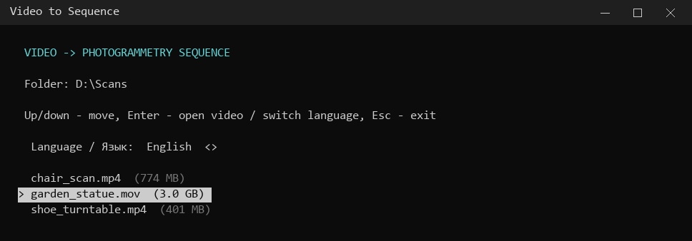
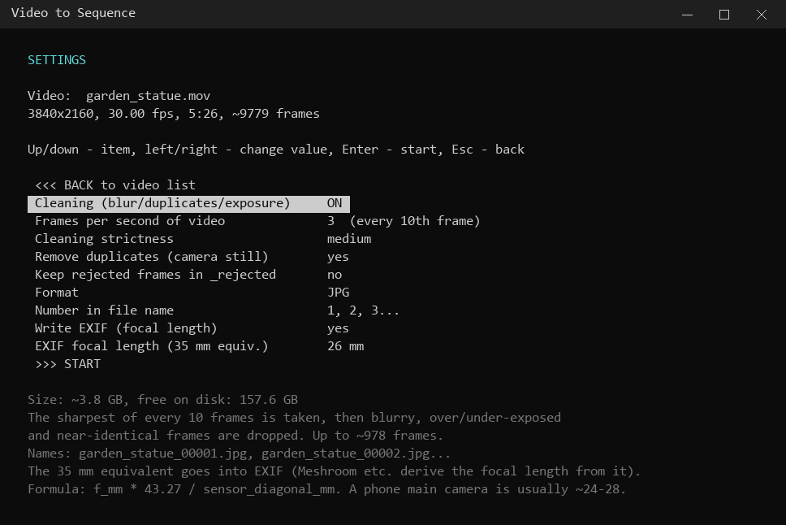
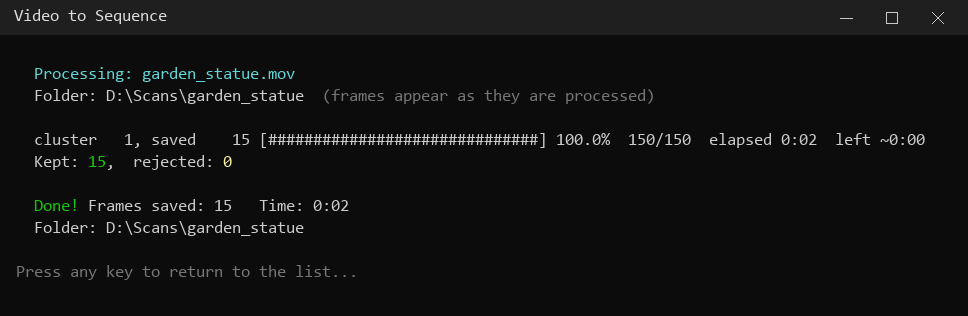
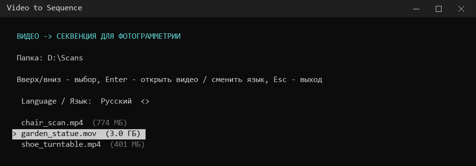
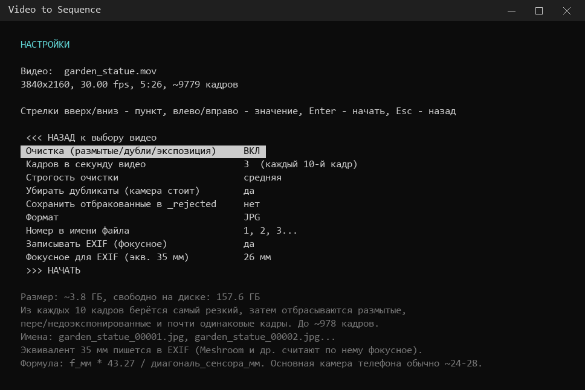
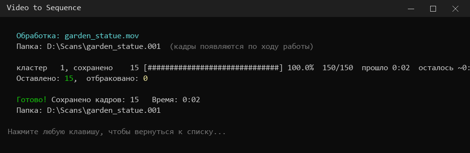

# Video to Sequence

**English** · [Русский](#видео-в-секвенцию)

A single-file Windows tool that turns a video into a clean image sequence for photogrammetry (Meshroom / AliceVision, RealityCapture, Metashape, COLMAP…). Put `make_sequence.bat` next to your videos, double-click it and pick a video with the arrow keys. It extracts frames, throws away blurry, badly exposed and duplicate ones, and writes the focal length into EXIF so the photogrammetry software starts with the right camera intrinsics.

## Features

- **Keyboard menu in the console**: arrow keys and Enter, no command-line arguments.
- **Frame cleaning (optional)**:
  - picks the sharpest frame out of every N frames;
  - drops blurry frames by comparing them to their neighbours and to the whole video;
  - drops frames that are too dark or too bright;
  - drops near-identical frames (camera standing still).
- **Realtime saving**: frames appear in the output folder while the video is still being processed.
- **EXIF focal length (optional)**: writes `FocalLength` and `FocalLengthIn35mmFilm`, plus a per-video serial number so all frames are treated as one camera.
- **No overwriting**: output goes to a folder named after the video, or to `name.001`, `name.002`… if that folder already exists.
- **Disk space check**: estimated sequence size and free space are shown before you start.
- **English / Russian interface**, settings are remembered in `make_sequence.json`.

## Requirements

| What | How to get it |
|---|---|
| Windows 10 / 11 | — |
| Python 3.8+ | [python.org](https://www.python.org/downloads/), tick **"Add python.exe to PATH"** |
| ffmpeg + ffprobe | `winget install Gyan.FFmpeg`, or put `ffmpeg.exe` and `ffprobe.exe` next to the `.bat` |
| opencv-python, numpy | installed automatically on the first run with cleaning enabled (`pip install --user`) |

## Usage

1. Copy `make_sequence.bat` into the folder with your videos.
2. Double-click it.
3. **Page 1**: choose the interface language (top line) and a video. Enter opens the video, Esc exits.
4. **Page 2**: change settings with ←/→, then press Enter on any item to start. The first item, `<<< BACK`, returns to the video list.
5. Wait for processing. Frames are saved to `<video name>\<video name>_00001.jpg`, … (see *Number in file name*).

### Settings

| Setting | Values | Meaning |
|---|---|---|
| Cleaning | ON / OFF | Analyse frames and drop bad ones. OFF exports frames as is (fast). |
| Frames per second of video | 1, 2, 3, 4, 5, 6, 10, 15, all | How many frames per second of video to take. With cleaning ON the sharpest frame of each window is used; default 3. With cleaning OFF the default is **all**. Each mode remembers its own value. |
| Cleaning strictness | soft / medium / strict | How much sharper than its neighbours a frame must be. |
| Remove duplicates | yes / no | Drop frames almost identical to the previous kept one. |
| Keep rejected frames | yes / no | Save dropped frames to `_rejected\` with the reason in the file name, so you can check what was removed. |
| Format | JPG / PNG | JPG quality 95 (~1–3 MB for 4K), PNG lossless (~25–30 MB for 4K). |
| Number in file name | 1, 2, 3… / 0, 1, 2… / video frame number (from 0) | How frames are numbered: consecutively from 1, consecutively from 0, or by the frame's index in the original video (e.g. `_00000`, `_00010`, `_00020`… at every 10th frame). The settings page shows example names. |
| Write EXIF | yes / no | Turn focal-length EXIF on or off. |
| EXIF focal length | 13–85 mm | 35 mm equivalent focal length of the camera that shot the video. |

**How to find the 35 mm equivalent:** `f35 = f_mm × 43.27 / sensor_diagonal_mm`. Phone main cameras are usually 24–28 mm (the default is 26). Note that video often uses a crop of the sensor, so the equivalent for video can differ from the one for photos.

## How it works

1. `ffprobe` reads resolution, frame rate and frame count.
2. **Cleaning OFF**: `ffmpeg` writes every N-th frame directly. EXIF is added afterwards if enabled.
3. **Cleaning ON**: `ffmpeg` streams decoded frames to Python in a single pass:
   - every frame is downscaled to 960 px for analysis;
   - sharpness = variance of the Laplacian, plus mean brightness;
   - in each window of N frames the sharpest well-exposed frame becomes a *candidate*;
   - candidates are judged in clusters of 30, each compared with ±7 neighbours. A candidate is rejected as **blur** if it is clearly less sharp than the local median or the median of the whole video, as **exposure** if its mean brightness is outside 15–240, or as **duplicate** if its 64×36 thumbnail barely differs from the last kept frame;
   - accepted frames are encoded in background threads and written to disk immediately.
4. Settings are saved to `make_sequence.json` next to the `.bat`.

## Limitations

- **Windows only**: it is a `.bat` file and reads the keyboard through `msvcrt`. It must be run in a real console window (cmd / Windows Terminal), not in an IDE output panel.
- **Same intrinsics for all frames**: one focal length is written to every frame. Videos with zoom or changing lenses will get wrong EXIF, so turn EXIF off for them.
- **No real camera data**: the video file's camera make, model, GPS and lens data are not copied. Make is `VideoToSeq`, model is `Video <W>x<H>`.
- **8-bit output**: with cleaning ON frames go through 8-bit YUV 4:2:0, so HDR / 10-bit video is converted without tone mapping and may look flat.
- **Only the first video stream** is used. Audio and other streams are ignored.
- **Heuristic cleaning**: the sharpness measure can't tell motion blur from out-of-focus blur or from a plain, low-texture surface. On scenes with large textureless areas use the *soft* strictness, or keep rejected frames and check them.
- **Numbers have gaps** in the *video frame number* mode, since dropped frames leave holes. Some tools expect a continuous sequence; use 0, 1, 2… or 1, 2, 3… for them.
- **Disk space**: 4K PNG takes ~28 MB per frame, so a 5-minute video at "all" frames needs ~270 GB. Check the size estimate in the settings before you start.
- Performance depends on the CPU. Decoding uses hardware acceleration when ffmpeg supports it (`-hwaccel auto`).

## License

[MIT](LICENSE)

---

# Видео в секвенцию

[English](#video-to-sequence) · **Русский**

Однофайловая утилита для Windows: превращает видео в чистую секвенцию кадров для фотограмметрии (Meshroom / AliceVision, RealityCapture, Metashape, COLMAP…). Положите `make_sequence.bat` рядом с видео, запустите двойным кликом и выберите видео стрелками. Утилита вытащит кадры, выбросит размытые, засвеченные или тёмные и повторяющиеся и запишет фокусное расстояние в EXIF, чтобы программа фотограмметрии сразу знала параметры камеры.

## Возможности

- **Меню в консоли с управлением стрелками** и Enter, без аргументов командной строки.
- **Очистка кадров (по желанию)**:
  - из каждых N кадров берётся самый резкий;
  - размытые кадры отбрасываются по сравнению с соседями и со всем видео;
  - отбрасываются слишком тёмные или светлые кадры;
  - отбрасываются почти одинаковые кадры (камера стоит).
- **Сохранение по ходу работы**: кадры появляются в папке, пока видео ещё обрабатывается.
- **Фокусное в EXIF (по желанию)**: пишутся `FocalLength` и `FocalLengthIn35mmFilm`, а также серийный номер видео, чтобы все кадры считались снятыми одной камерой.
- **Без перезаписи**: кадры сохраняются в папку с именем видео, а если она уже есть, то в `имя.001`, `имя.002`…
- **Проверка места на диске**: перед стартом показывается примерный размер секвенции и свободное место.
- **Интерфейс на английском и русском**, настройки запоминаются в `make_sequence.json`.

## Что нужно

| Что | Где взять |
|---|---|
| Windows 10 / 11 | — |
| Python 3.8+ | [python.org](https://www.python.org/downloads/), отметьте **«Add python.exe to PATH»** |
| ffmpeg + ffprobe | `winget install Gyan.FFmpeg` или положите `ffmpeg.exe` и `ffprobe.exe` рядом с `.bat` |
| opencv-python, numpy | ставятся сами при первом запуске с очисткой (`pip install --user`) |

## Как пользоваться

1. Скопируйте `make_sequence.bat` в папку с видео.
2. Запустите двойным кликом.
3. **Страница 1**: выберите язык интерфейса (верхняя строка) и видео. Enter открывает видео, Esc закрывает программу.
4. **Страница 2**: меняйте настройки стрелками ←/→ и нажмите Enter на любом пункте, чтобы начать. Первый пункт, `<<< НАЗАД`, возвращает к списку видео.
5. Дождитесь окончания. Кадры сохраняются в `<имя видео>\<имя видео>_00001.jpg`, … (см. *Номер в имени файла*).

### Настройки

| Пункт | Значения | Что делает |
|---|---|---|
| Очистка | ВКЛ / ВЫКЛ | Анализировать кадры и выбрасывать плохие. ВЫКЛ — просто экспорт (быстро). |
| Кадров в секунду видео | 1, 2, 3, 4, 5, 6, 10, 15, все | Сколько кадров брать с каждой секунды видео. С очисткой из каждого окна берётся самый резкий кадр, по умолчанию 3. Без очистки по умолчанию **все**. Значение запоминается для каждого режима отдельно. |
| Строгость очистки | мягкая / средняя / строгая | Насколько кадр может быть мягче соседей. |
| Убирать дубликаты | да / нет | Выбрасывать кадры, почти не отличающиеся от предыдущего сохранённого. |
| Сохранить отбракованные | да / нет | Сохранять выброшенные кадры в `_rejected\` с причиной в имени файла, чтобы можно было проверить, что удалено. |
| Формат | JPG / PNG | JPG качество 95 (~1–3 МБ на 4K-кадр), PNG без потерь (~25–30 МБ на 4K-кадр). |
| Номер в имени файла | 1, 2, 3… / 0, 1, 2… / номер кадра в видео (с 0) | Как нумеруются кадры: подряд с 1, подряд с 0 или по номеру кадра в исходном видео (например `_00000`, `_00010`, `_00020`… при каждом 10-м кадре). На странице настроек показан пример имён. |
| Записывать EXIF | да / нет | Включает или выключает запись фокусного в EXIF. |
| Фокусное для EXIF | 13–85 мм | Эквивалентное фокусное (35 мм) камеры, которой снято видео. |

**Как узнать эквивалент 35 мм:** `f35 = f_мм × 43.27 / диагональ_сенсора_мм`. У основной камеры телефона обычно 24–28 мм (по умолчанию 26). Видео часто снимается с кропом сенсора, поэтому эквивалент для видео может отличаться от фото.

## Как это работает

1. `ffprobe` узнаёт разрешение, частоту и число кадров.
2. **Без очистки** `ffmpeg` сам пишет каждый N-й кадр. Если включён EXIF, он дописывается потом.
3. **С очисткой** `ffmpeg` за один проход передаёт декодированные кадры в Python:
   - каждый кадр для анализа уменьшается до 960 px;
   - резкость считается как дисперсия лапласиана, плюс средняя яркость;
   - в каждом окне из N кадров самый резкий кадр с нормальной экспозицией становится *кандидатом*;
   - кандидаты оцениваются кластерами по 30, каждый сравнивается с ±7 соседями. Кандидат отбраковывается как **размытие**, если он заметно мягче локальной медианы или медианы всего видео; как **экспозиция**, если средняя яркость вне 15–240; как **дубликат**, если его миниатюра 64×36 почти не отличается от последнего сохранённого кадра;
   - принятые кадры кодируются в фоновых потоках и сразу пишутся на диск.
4. Настройки сохраняются в `make_sequence.json` рядом с `.bat`.

## Ограничения

- **Только Windows**: это `.bat`, а клавиши читаются через `msvcrt`. Запускать нужно в настоящем окне консоли (cmd / Windows Terminal), а не в панели вывода IDE.
- **Одинаковые параметры камеры для всех кадров**: во все кадры пишется одно фокусное. Для видео с зумом или сменой объектива EXIF будет неверным, отключите его.
- **Нет реальных данных камеры**: производитель, модель, GPS и данные объектива из видео не переносятся. В EXIF Make = `VideoToSeq`, Model = `Video <Ш>x<В>`.
- **8 бит**: с очисткой кадры проходят через 8-битный YUV 4:2:0, поэтому HDR и 10-битное видео конвертируется без тонмаппинга и может выглядеть блёклым.
- **Берётся только первый видеопоток**, звук и другие потоки игнорируются.
- **Очистка эвристическая**: резкость не отличает смаз от расфокуса и от просто однотонной поверхности. Для сцен с большими участками без текстуры выбирайте *мягкую* строгость или сохраняйте отбракованные кадры и проверяйте их.
- **В режиме «номер кадра в видео» нумерация с пропусками**, ведь отброшенные кадры оставляют дыры. Некоторые программы ждут непрерывную секвенцию, для них выбирайте 0, 1, 2… или 1, 2, 3….
- **Место на диске**: 4K PNG занимает ~28 МБ на кадр, 5 минут видео со всеми кадрами — ~270 ГБ. Проверьте оценку размера в настройках перед стартом.
- Скорость зависит от процессора. Декодирование использует аппаратное ускорение, если ffmpeg его поддерживает (`-hwaccel auto`).

## Лицензия

[MIT](LICENSE)
